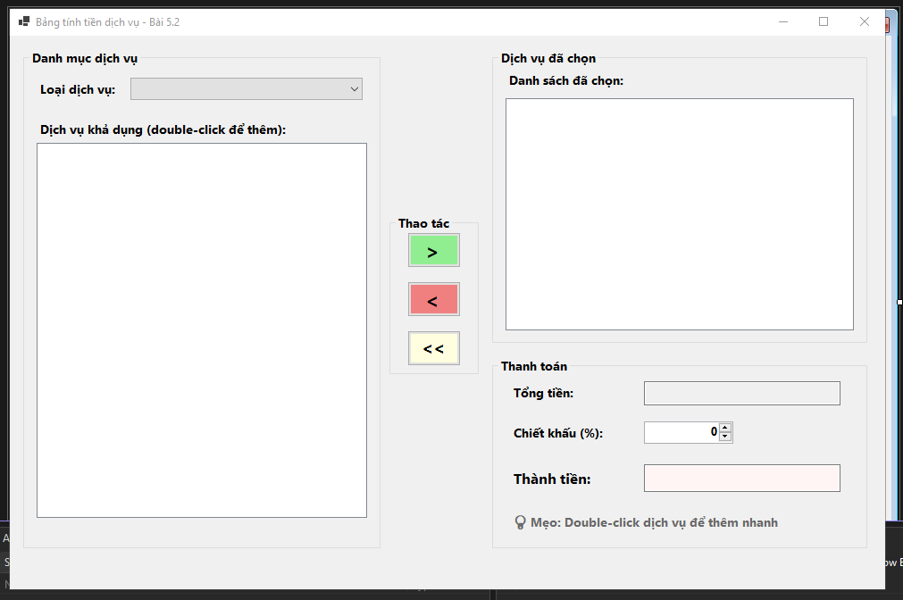
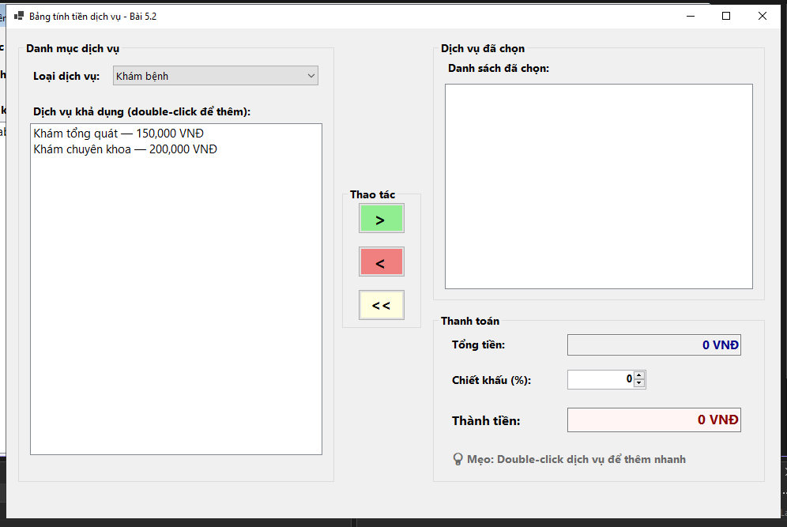
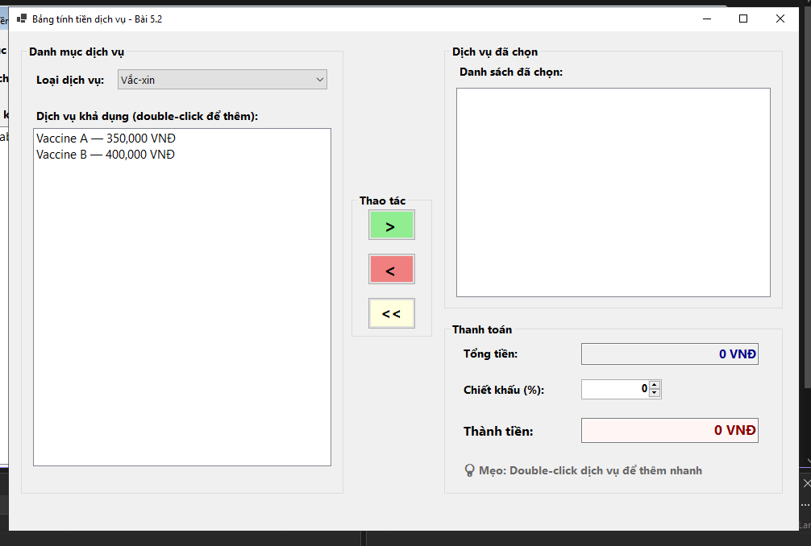
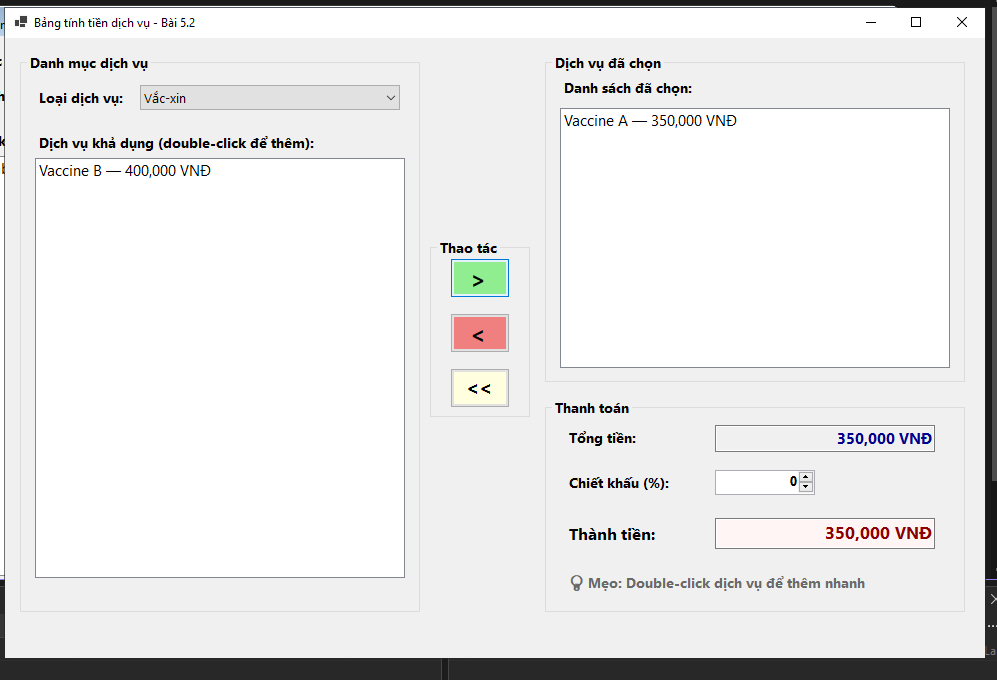
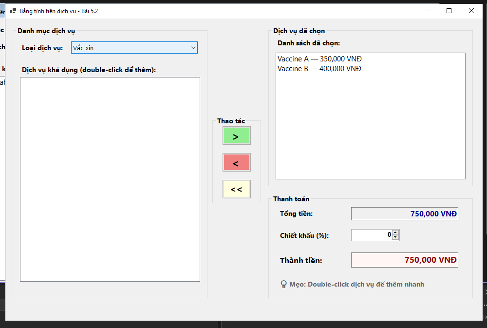

# BÁO CÁO BÀI TẬP

## THÔNG TIN SINH VIÊN
- **Họ và tên: Đặng Cao Thành Đạt**
- **Mã số sinh viên: 24810320215** 
- **Lớp: D19QTANM1** 
- **Tên môn học: Lập Trình.Net** 
- **Tên bài tập: BÀI 5.2: BẢNG TÍNH TIỀN DỊCH VỤ VÀ CHIẾT KHẤU ĐƠN HÀNG
(LISTBOX & COMBOBOX)** 

---

## KẾT QUẢ THỰC HÀNH

### 1. Ảnh màn hình Giao diện chính

### 2..1 Khi thay đổi mục chọn trên ComboBox, load danh sách món/dịch vụ tương ứng vào lstAvailableServices.

### 2.2 Khi thay đổi mục chọn trên ComboBox, load danh sách món/dịch vụ tương ứng vào lstAvailableServices.

### 3. Khi nhấn nút > hoặc Double Click vào một item ở lstAvailableServices, chuyển item đó sang lstSelectedServices.

### 4. Tự động tính lại tổng chi phí dựa trên đơn giá của các dịch vụ nằm trong lstSelectedServices mỗi khi có sự thay đổi danh sách.
